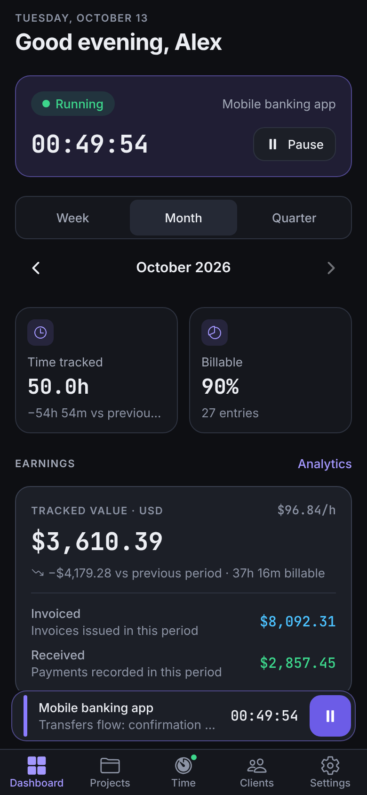
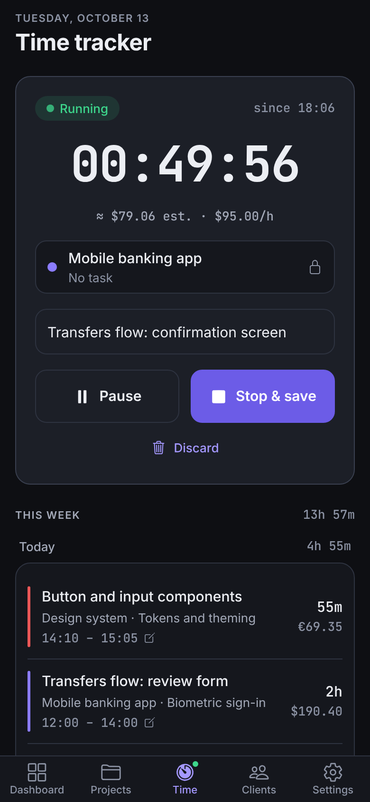
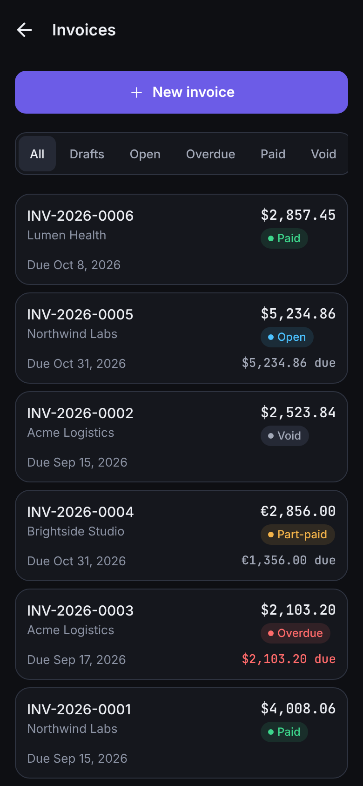
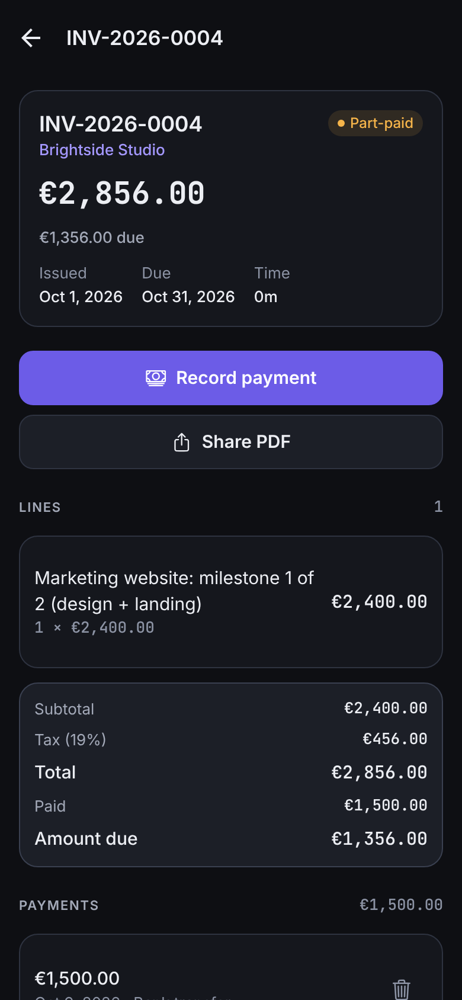
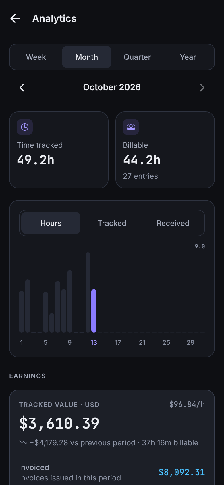
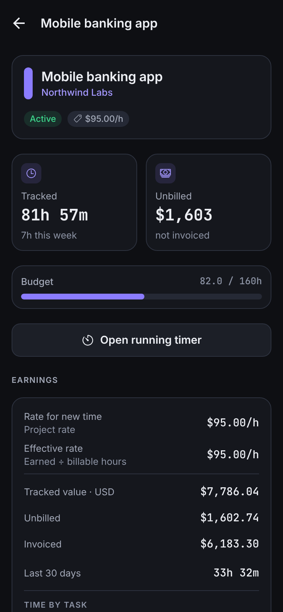
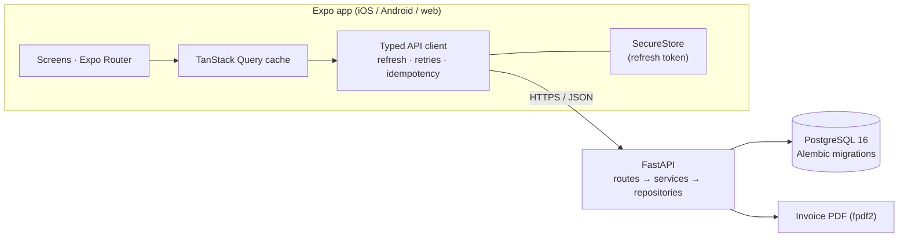

# FreelanceHub

**Time tracking, invoicing and earnings for freelancers — a full-stack mobile app (React Native + FastAPI).**

Track time with a timer that survives app restarts and bad networks, bill it with invoices that always add up,
and see what you have *tracked*, *invoiced* and actually *received* — per currency, never mixed.

<p align="center">
  
  
  
</p>
<p align="center">
  
  
  
</p>

> Screenshots show the built-in demo account (`python -m app.cli.seed_demo`), not mock-ups: every number is
> computed by the backend from ~160 time entries and 7 invoices.

## Features

- **Timer** — start, pause, resume, stop; one active entry per user; elapsed time is always derived from stored
  timestamps, so it is right after backgrounding, a restart or a phone that was offline.
- **Clients, projects, tasks** — hourly, fixed-fee and non-billable projects, budgets with progress, per-project rates.
- **Invoices** — build from unbilled time in a few taps, add custom lines and tax, edit drafts, send (numbered
  `INV-2026-0001`), record partial payments, void, share a **PDF**.
- **Dashboard & analytics** — tracked value vs invoiced vs received, unbilled / outstanding / overdue balances,
  activity chart, breakdown by project or client, effective hourly rate.
- **CSV export** of time entries and invoices (Excel-friendly, formula-injection safe).
- **English, Ukrainian, Russian**; dark "developer" design system; loading, empty, error and offline states throughout.

## Engineering highlights

| Area | What was done |
|------|---------------|
| Reliable time tracking | Server-side state machine; `FOR NO KEY UPDATE` per-user lock serialises commands; idempotency keys + client-generated IDs make retries safe; server-clock offset on the device; optimistic UI with rollback |
| Money correctness | `Decimal` + `NUMERIC` only, half-up to cents in one module; totals are sums of rounded lines; tax once on the subtotal; DB checks such as `total = subtotal + tax`; rate snapshot on every entry; currencies never added together |
| Invoices | Entries locked while on an invoice; gapless numbers assigned on send under the lock (concurrency-tested); optimistic locking with `version` — a stale form gets a conflict instead of overwriting another device's change |
| Security | Argon2id passwords; short-lived JWT + rotating refresh tokens with reuse detection; refresh token only in the iOS Keychain / Android Keystore (Expo SecureStore), access token only in memory; every query scoped by user, composite ownership FKs; cross-user tests |
| Time zones | Ranges, "today", overdue and charts use the user's IANA zone; DST and week-start tested |
| API | REST with typed Pydantic contracts, RFC 9457 errors mapped onto form fields, cursor pagination, OpenAPI at `/docs` |
| Tests | **276** backend tests (pytest, real PostgreSQL), **149** mobile tests (Jest + React Native Testing Library), and two Playwright end-to-end suites (timer 25 checks, money 29 checks) that verify every step in the database |

## Architecture



- **Mobile** (`mobile/`): Expo SDK 57, Expo Router, strict TypeScript, TanStack Query, React Hook Form + Zod,
  Zustand only for session/offline state, i18next. Feature-oriented folders; business rules stay out of screens.
- **Backend** (`backend/`): FastAPI, SQLAlchemy 2.x, Alembic (5 reversible migrations), Pydantic v2, pytest.
- **Docs** (`docs/`): [architecture](docs/architecture.md), [database](docs/database.md), [API](docs/api.md),
  [time-tracking invariants](docs/time-tracking.md), [roadmap](docs/roadmap.md);
  conventions and definition of done in [CONTRIBUTING.md](CONTRIBUTING.md).

## Run it in 2 minutes

```bash
cp .env.example .env                                   # set POSTGRES_PASSWORD and JWT_SECRET
docker compose up -d --build                           # API on http://localhost:8000 (docs at /docs)
docker compose exec api python -m app.cli.seed_demo    # demo@freelancehub.app / FreelanceHub-demo-2026

cd mobile && npm install && npx expo start             # scan the QR code with Expo Go
```

On Windows the same steps are in `scripts/start-backend.cmd`, `scripts/seed-demo.cmd` and `scripts/test-backend.cmd`.
Tests: `docker compose exec api pytest` and `cd mobile && npm run check`.

## Status

Built as a portfolio project. Implemented: everything above. Next on the roadmap: manual time-entry screens,
a persisted offline command queue, sending invoices by email, deployment and store builds.
