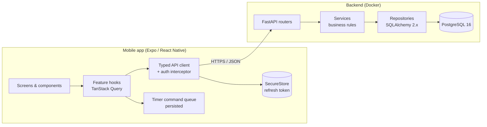
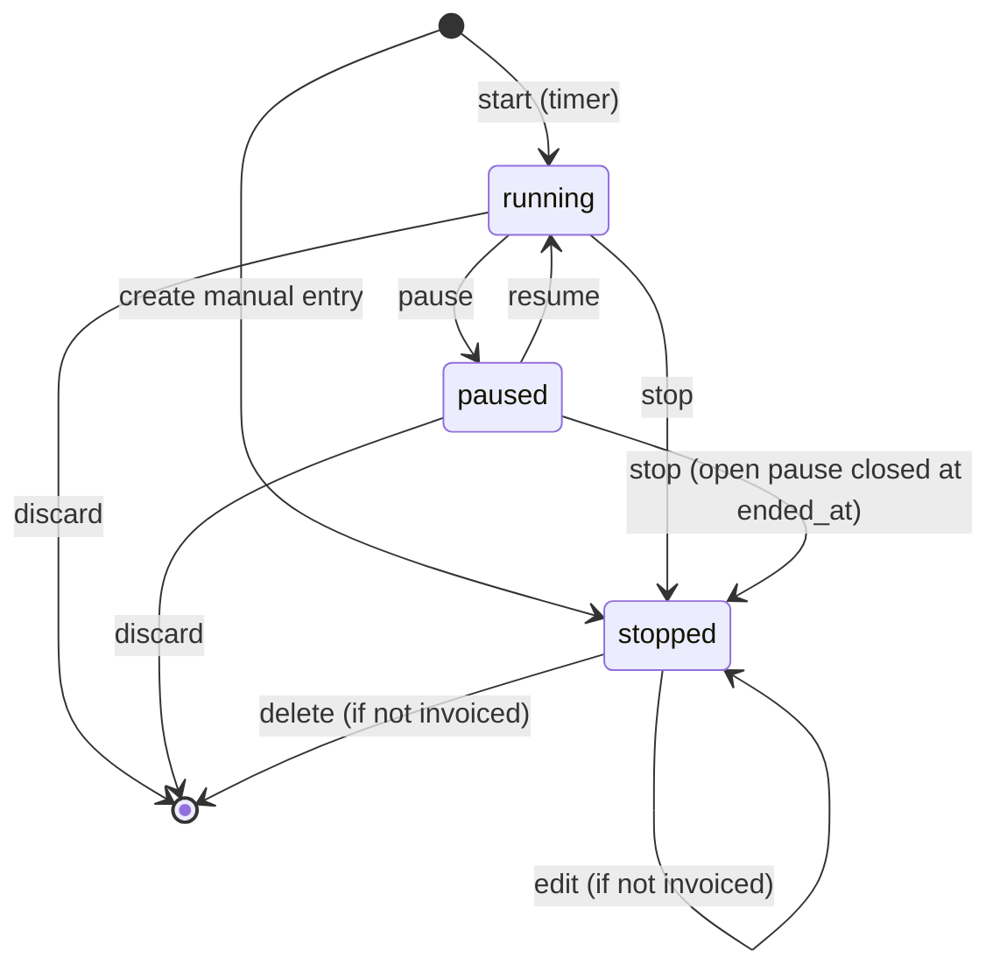

# FreelanceHub — Architecture

> Status: **v0.5 — implemented** (backend, mobile, invoices and analytics); sections marked *planned* are not built yet.
> Last updated: 2026-10-12. Related: [database.md](database.md) · [api.md](api.md) · [roadmap.md](roadmap.md)

## 1. Goals and scope

FreelanceHub is a mobile app (Android and iOS) that helps a solo freelancer manage clients, projects, tasks,
time tracking, and earnings. **Reliable time tracking** sets it apart, so most of the
correctness work goes there.

In scope for v1 (MVP): auth, clients, projects, tasks, timer and manual time entries, earnings calculation,
dashboard and analytics, and CSV export.
Planned next: invoices, payments, and invoice PDF.
Out of scope: teams and multi-user workspaces, FX conversion, integrations (Stripe, calendars), web client, push notifications.

## 2. Assumptions

| # | Assumption | Impact if wrong |
|---|------------|-----------------|
| A-1 | One account = one freelancer. No teams, roles, or sharing. | Every table would need a `workspace_id` with role checks. |
| A-2 | A **paused** entry still counts as the user's active entry. A new timer cannot start while one is paused. | Changes the partial unique index and the timer UX. |
| A-3 | Time entries of one user **must not overlap** in time (enforced in the DB). | Overlap would allow double billing. Relaxing it means dropping the exclusion constraint. |
| A-4 | Supported currencies use 2 minor digits (USD, EUR, GBP, CAD, AUD, CHF, PLN, UAH, CZK, SEK, NOK, DKK). No FX conversion. Totals are always grouped by currency. | Supporting JPY and similar currencies requires per-currency minor units. |
| A-5 | Hourly rates have at most 2 decimal places. | — |
| A-6 | Server time is authoritative. The client may pass an `at` timestamp only for commands queued while offline, and the server validates it. | — |
| A-7 | Offline support covers **timer commands only** (start/pause/resume/stop). Other mutations need a network connection. Reads are served from the cache. | Full offline CRUD would need a sync engine (significant extra scope). |
| A-8 | An entry that crosses midnight is attributed to the local date of `started_at` (user timezone) in analytics. | Splitting entries across days would complicate the aggregations. |
| A-9 | Email verification and password reset are deferred (Phase 9). Registration needs only email and password. | — |
| A-10 | UI languages: English, Ukrainian, Russian (i18next). Default follows the device language; the user can override it in Settings. Demo/user data (project names, descriptions) is never translated. | Adding a language = one locale file + tests. |
| A-11 | The deployment target is not decided yet. The design must work with any container host and managed Postgres. | — |

## 3. System overview



## 4. Repository layout

```
FreelanceHub/
├── README.md
├── CONTRIBUTING.md                 # conventions and definition of done
├── docs/                       # design docs (this folder)
├── backend/
│   ├── app/
│   │   ├── main.py             # app factory, middleware, exception handlers
│   │   ├── core/               # config (pydantic-settings), security, logging, errors
│   │   ├── db/                 # engine, session, base model, naming conventions
│   │   ├── models/             # SQLAlchemy ORM models
│   │   ├── schemas/            # Pydantic request/response DTOs
│   │   ├── repositories/       # DB access, always scoped by user_id
│   │   ├── services/           # business logic (timer, money, auth, analytics…)
│   │   └── api/v1/             # routers + dependencies (current_user, idempotency)
│   ├── alembic/                # migrations
│   ├── tests/                  # unit/ (pure logic) + integration/ (API + real Postgres)
│   ├── pyproject.toml          # deps, ruff, mypy, pytest config
│   └── Dockerfile
├── mobile/
│   ├── app/                    # Expo Router routes (thin: compose feature components)
│   ├── src/
│   │   ├── features/<feature>/ # api.ts, hooks.ts, schemas.ts, components/, utils
│   │   └── shared/             # api client, ui kit, theme, lib/money, lib/time
│   ├── app.config.ts
│   └── package.json
├── docker-compose.yml          # api + postgres (+ test db)
├── .env.example
└── .github/workflows/          # backend.yml, mobile.yml
```

## 5. Backend architecture

### 5.1 Layers

| Layer | Responsibility | Must not |
|-------|----------------|----------|
| `api` (routers) | HTTP parsing, auth dependency, status codes, mapping DTOs | Contain business rules or raw SQL |
| `schemas` | Pydantic v2 DTOs, input validation, decimal-as-string serialization | Touch the DB |
| `services` | Business rules, state machine, money math, transaction boundaries | Know about HTTP |
| `repositories` | Queries; **every query takes `user_id`** and filters by it | Decide business outcomes |
| `models` | ORM mappings, DB-level constraints | — |

### 5.2 Key backend decisions

- **Sync SQLAlchemy 2.x + psycopg 3** (see ADR-03). FastAPI runs sync endpoints in its threadpool.
- **One transaction per request**: the session is opened in a dependency, and the service commits once at the end. Errors roll back.
- **Pessimistic lock on the timer row**: `SELECT … FOR UPDATE` on the user's active entry for every timer command.
- **Errors**: domain exceptions (`NotFound`, `Conflict`, `ValidationFailed`, …) are mapped centrally to RFC 9457 Problem Details with a stable `code` (see [api.md §2](api.md)).
- **Config**: `pydantic-settings`, read from the environment only. `.env.example` is committed and `.env` is git-ignored.
- **Logging**: structured JSON logs with a request ID. A redaction filter drops `password`, `token`, `authorization`, and `refresh_token` keys. Request bodies are never logged.
- **Tooling**: ruff (lint + format), mypy `--strict` on `app/`, pytest with coverage. Integration tests run against real Postgres (docker compose service), because they depend on the exclusion constraints, partial indexes, and `FOR UPDATE`.

## 6. Authentication flow

### 6.1 Design

- **Password hashing**: Argon2id (`argon2-cffi`, library defaults, parameters tuned to roughly 100 ms on the server).
- **Access token**: JWT (HS256, PyJWT), **15 min** TTL, claims `sub` (user UUID), `exp`, `iat`, `jti`, `type=access`. Stateless. The user ID comes **only** from this claim, never from the client body.
- **Refresh token**: an opaque 256-bit random string (`secrets.token_urlsafe(32)`), **30-day** TTL. Only its **SHA-256 hash** is stored (`refresh_tokens`).
- **Rotation + reuse detection**: every refresh revokes the presented token and issues a new one in the same `family_id`. If an already-rotated token is presented again, the **whole family is revoked** and the user must log in again.
- **Concurrency grace**: the mobile client refreshes in a single-flight way. On the server, a token rotated less than 10 s ago that is presented again returns 401 `TOKEN_ROTATED` but does **not** revoke the family. This avoids false positives from network retries.
- **Logout** revokes the current family. **Logout-all** revokes every family of the user. **Password change** revokes all families except the current one.
- **Brute force**: rate limit on `/auth/login` and `/auth/register` (per IP + email, `slowapi`, in-process for the MVP). Login failures return a generic `INVALID_CREDENTIALS`.

### 6.2 Mobile token handling

> Implemented in `mobile/src/shared/api/` (client, tokens) and `mobile/src/features/auth/` (session, store).

- The refresh token is stored in **Expo SecureStore** (Keychain / Android Keystore, `AFTER_FIRST_UNLOCK_THIS_DEVICE_ONLY`).
  It is written to the keystore **before** the new access token is used, because the old refresh token is already
  revoked server-side.
- The access token is kept **in memory only** and is re-acquired on app start through `/auth/refresh` (splash stays up).
- **Web** has no encrypted storage, so both tokens stay in memory and a reload ends the session. Nothing secret is ever
  written to AsyncStorage/localStorage (asserted by unit tests and by the end-to-end run).
- The API client attaches `Authorization: Bearer …`. On any `401` except `INVALID_CREDENTIALS` it runs **one shared
  refresh promise** (single-flight) and retries the request once; requests that started with an old token reuse a
  token another request already obtained instead of rotating again.
- If the refresh token is rejected (`401`/`422`), the client clears SecureStore, the query cache, the timer snapshot
  and the cached profile, and the router guard shows sign-in. If refresh fails only because the **network** is down,
  the stored session is kept: the app opens from the cached (non-secret) profile and an offline banner is shown.

```mermaid
sequenceDiagram
  participant App
  participant API
  participant DB
  App->>API: POST /auth/login {email, password}
  API->>DB: load user, verify Argon2id
  API->>DB: insert refresh_token(hash, family_id)
  API-->>App: {access_token, refresh_token, expires_in, user}
  App->>App: SecureStore.set(refresh) / memory(access)
  Note over App,API: …15 min later…
  App->>API: GET /projects (expired access)
  API-->>App: 401 TOKEN_EXPIRED
  App->>API: POST /auth/refresh {refresh_token}
  API->>DB: SELECT … FOR UPDATE by hash; check not revoked/expired
  API->>DB: revoke old, insert new (same family)
  API-->>App: new pair
  App->>API: retry GET /projects
```

## 7. Time tracking

### 7.1 Model

> Full invariant list with enforcement and proofs: [time-tracking.md](time-tracking.md).


A time entry stores **authoritative timestamps**: `started_at`, `ended_at`, and a list of pause intervals
(`time_entry_pauses`). Elapsed time is always **derived**:

```
net_seconds = floor( (end − started_at) − Σ (pause.resumed_at|end − pause.paused_at) )
end         = ended_at if stopped, else now()   (server now, or client now + offset for display)
```

When an entry stops, `duration_seconds` and `billable_amount` are computed once and stored, so
reports never recompute history.

### 7.2 State machine



| Command | Allowed from | Effect | Error otherwise |
|---------|--------------|--------|-----------------|
| `start` | no active entry | insert entry `status=running`, snapshot the rate | `409 ACTIVE_TIMER_EXISTS` (body includes the active entry) |
| `pause` | `running` | insert pause `{paused_at=at}`, `status=paused` | `409 INVALID_TRANSITION` |
| `resume` | `paused` | set `resumed_at=at` on the open pause, `status=running` | `409 INVALID_TRANSITION` |
| `stop` | `running`, `paused` | close any open pause, set `ended_at`, compute duration and amount, `status=stopped` | `409 INVALID_TRANSITION` |
| `discard` | `running`, `paused` | hard-delete the entry and its pauses | `409 INVALID_TRANSITION` |
| `edit` | `stopped`, `invoice_id IS NULL` | change times, description, task, billable, or project; recompute | `409 ENTRY_LOCKED` |

Pause, resume, stop, and discard address the entry **by ID** (`/timer/{entry_id}/…`). A delayed command for entry A
can therefore never stop entry B, which another device may have started later. A mismatch returns `409 TIMER_MISMATCH`.

### 7.3 Concurrency controls and consistency guarantees

| Guarantee | Mechanism |
|-----------|-----------|
| At most one active entry per user | Partial unique index `ux_time_entries_one_active ON (user_id) WHERE status IN ('running','paused')`. A violation is mapped to `409 ACTIVE_TIMER_EXISTS`. |
| No overlapping entries | `EXCLUDE USING gist (user_id WITH =, tstzrange(started_at, ended_at, '[)') WITH &&)`. A running entry has an open upper bound, so nothing can be added after its start. |
| Only one open pause per entry | Partial unique index on `time_entry_pauses(time_entry_id) WHERE resumed_at IS NULL`. |
| Serialised transitions | Every timer command first takes `SELECT … FROM users FOR NO KEY UPDATE` (per-user lock; NO KEY so it never deadlocks with FK checks), then reads the clock, then locks the entry row. Two concurrent stops serialise: the second sees `stopped` and gets `INVALID_TRANSITION`, unless it is an idempotent replay. |
| Safe retries (no duplicates) | (1) `start` carries a **client-generated UUID** for the entry, so a repeated start with the same ID returns the existing entry. (2) All timer and create endpoints require an `Idempotency-Key`. The key and the stored response (exact bytes, `TEXT`) are written **in the same transaction** as the mutation, so a replay returns the original response byte-for-byte; errors are never cached. Reusing a key with a different payload returns `422 IDEMPOTENCY_KEY_REUSED`. |
| Lost updates on edit | Optimistic locking: `time_entries.version`. `PATCH` must send `version`, and a mismatch returns `409 VERSION_CONFLICT`. |
| Valid timeline | CHECKs: `ended_at > started_at`; `status='stopped' ⇔ ended_at IS NOT NULL`; pause `resumed_at >= paused_at`. The service validates that each pause lies within `[started_at, ended_at]`. |
| Historical immutability | The rate snapshot is never changed by ordinary edits. Entries with `invoice_id` are locked. |

### 7.4 Client-supplied timestamps (`at`)

Timer commands accept an optional `at` (ISO-8601 with offset) for commands queued while offline. Rules:
- When `at` is missing, the server uses `now()`.
- `at > server_now + 60 s` → rejected `422 TIMESTAMP_IN_FUTURE`. Values from 0 to 60 s ahead are clamped to `now()` (clock skew).
- `at` must be ≥ the entry's last transition (`started_at`, last `paused_at`/`resumed_at`), else `422 TIMESTAMP_OUT_OF_ORDER`.
- `start.at` must not be older than 7 days.

### 7.5 Mobile behaviour (restart, lifecycle, network)

> Implemented in `mobile/src/features/timer/` (`api.ts`, `clock.ts`, `persistence.ts`, `hooks.ts`, `model.ts`).

- **Display** uses timestamps, not a counter. A 1 s interval only re-renders; elapsed time is
  `serverNow − started_at − pauses` with `serverNow = Date.now() + serverOffset`. A paused entry is frozen at the start
  of its open pause, so it never drifts.
- **Clock offset**: every timer response carries `server_time`; the client estimates
  `serverOffset = server_time − (sent + received) / 2` (request midpoint) and keeps the latest sample.
- **Restart / reopen**: the last **server-confirmed** state (`entry` + `serverOffset`, timestamps only, no secrets) is
  persisted in AsyncStorage per user and loaded into the query cache during the splash screen, so the timer shows the
  correct elapsed time before the network answers; `GET /timer/current` then replaces it. A snapshot of another user
  is ignored; sign-out deletes it.
- **AppState**: TanStack Query's focus manager is bound to `AppState`, so returning to the foreground refetches stale
  queries (the timer is stale after 10 s and also refetched every 60 s while visible, to pick up other devices).
- **Commands**: each user action gets one `Idempotency-Key`, a client-generated entry ID (start) and an `at` timestamp
  on the server clock, clamped to be after the last known transition. The UI updates optimistically with the same pure
  state machine as the server. Transient failures (network, timeout, 502/503/504) are retried up to 3 times with
  backoff **with the same key and body**, so a command that reached the server is replayed, never applied twice.
  Definitive errors roll the optimistic state back, refetch the server state and show a translated message. If the
  server rejects the client timestamp (`TIMESTAMP_*`, `TIME_OVERLAP`) the command is re-sent once without `at`
  (new key, since the body changes) so the server stamps it.
- **Not implemented yet**: a *persisted* offline queue (commands survive an app kill while offline) and the conflict
  sheet for two devices. Today a command issued offline is retried for a few seconds, then rolled back with an error.
- **Long-running guard**: an entry running for more than 10 h shows a banner (can be turned off in Settings).

## 8. Financial calculation rules

| Rule | Definition |
|------|------------|
| Types | Python `decimal.Decimal` (context precision 28). PostgreSQL `NUMERIC(10,2)` for rates and `NUMERIC(14,2)` for amounts. **No floats anywhere** on the authoritative path. |
| JSON | Money is serialised as **strings** (`"127.50"`) with an explicit `currency`. Durations are **integer seconds**. |
| Rate resolution at entry creation | `project.hourly_rate` → `client.default_hourly_rate` → `user.default_hourly_rate` → none. Currency comes from the same source. `rate_source` is recorded. |
| Snapshot | `hourly_rate_snapshot` and `currency` are copied onto the entry when it is **created** (start or manual). Later changes to project or client rates do not touch existing entries. |
| Entry amount | `billable_amount = quantize(duration_seconds × rate / 3600, 0.01, ROUND_HALF_UP)`. It is `NULL` when `billable = false` or there is no rate, which is different from `0.00`. |
| Duration rounding | `duration_seconds = floor(net seconds)`. No billing increments in the MVP (configurable 6/15-minute rounding is on the roadmap). |
| Totals | The **sum of per-entry rounded amounts**, never `round(Σ seconds × rate)`. This keeps invoice lines and totals reconcilable. |
| Multi-currency | Totals are grouped by currency and never added across currencies. The dashboard shows one card per currency. |
| Fixed-price projects | Entries carry no amount (`billable_amount NULL`). Analytics show hours and the *effective hourly rate* = fixed fee / hours. |
| Corrections | An ordinary `PATCH` recomputes duration and amount with the **same** snapshot. Changing `project_id` keeps the snapshot unless `reprice: true` is sent. That is the explicit correction: it re-resolves the rate and sets `rate_corrected_at`. Invoiced entries cannot be changed. |
| Money states | **Tracked** = value of billable stopped entries in a period (local date of `started_at`). **Unbilled** = tracked value not on a *sent or paid* invoice (entries reserved by a draft still count). **Invoiced** = totals incl. tax of invoices issued (`sent`/`paid`) with `issue_date` in the period. **Received** = payments with `paid_on` in the period. **Outstanding** = sent invoices − their payments; **overdue** = the part past `due_date`. The UI labels each one separately and never calls tracked value "earned" or "received". |
| Invoice lines | A time line copies the entry's stored `billable_amount` (never recomputed). A custom line = `quantize(quantity × unit_price, 0.01, HALF_UP)`. `subtotal = Σ line amounts`; `tax = quantize(subtotal × rate / 100, 0.01, HALF_UP)` once on the subtotal, not per line; `total = subtotal + tax` (DB check). Entries on an invoice (draft included) are locked. |
| Invoice numbers | `INV-YYYY-NNNN`, assigned on **send** under the per-user lock: drafts can be deleted freely, issued invoices only voided, so issued numbers have no gaps or duplicates. |
| Payments | Σ payments ≤ total (`422 OVERPAYMENT`); reaching the total sets `paid` + `paid_at`, deleting a payment reopens it. A void releases the entries and is refused while payments exist. |
| Periods & time zones | Ranges are local calendar dates in the user's IANA time zone, both ends inclusive, converted to UTC instants at local midnight (DST-safe via `zoneinfo`). Weeks honour `week_start`. "Today", "overdue" and payment-date defaults use the user's local date, not the server's. |
| Effective hourly rate | `quantize(amount × 3600 / priced seconds, 0.01, HALF_UP)`; for fixed-fee projects `fee / all tracked hours`. Display only. |
| Client-side preview | The running timer shows an *estimated* amount using integer cents: `round(seconds × rateCents / 3600)`, labelled "est.". The new-invoice form previews subtotal/tax/total in integer cents with the same half-up rule (unit-tested against the backend vectors). Neither is ever persisted: the server recomputes and the stored invoice is what is shown afterwards. |

Reference test vectors (the rounding unit tests must include these):

| Duration | Rate | Expected |
|----------|------|----------|
| 1 s | 100.00 | 0.03 |
| 5400 s (1 h 30 m) | 85.00 | 127.50 |
| 3601 s | 50.00 | 50.01 |
| 1200 s (20 m) | 33.33 | 11.11 |
| 1800 s | 0.01 | 0.01 (0.005 → half-up) |
| 0 s | 100.00 | 0.00 |

## 9. Mobile architecture

### 9.1 Principles

- Route files in `app/` are thin. Screens compose components from `src/features/*`.
- **Server state lives in TanStack Query.** Zustand is used only for genuinely client-side shared state: auth session
  status, server-clock offset, API reachability (offline banner) and device-local preferences.
- Forms use React Hook Form + Zod. The Zod schemas mirror the backend constraints. The server stays authoritative and its validation errors are mapped back to the form fields.
- Money is formatted from decimal strings with `Intl.NumberFormat`, and authoritative totals are never computed on the client.
- Query keys come from a single factory per feature. Mutations invalidate precise keys, for example a timer stop invalidates `timer.current`, `timeEntries.list`, and `dashboard.*`.

### 9.2 Navigation (Expo Router)

> Implemented (`mobile/src/app/`). Expo SDK 57 conventions: routes live in `src/app/`,
> JS tabs are imported from `expo-router/js-tabs`, and `ThemeProvider`/`DarkTheme` come from `expo-router`
> itself (there is no separate `@react-navigation/*` dependency). The guard is `Stack.Protected` in the root
> layout (no `(app)` group was needed); the current tree is in `mobile/README.md`. The planned full shape is below.

```
src/app/
├── _layout.tsx                 # providers: QueryClient, theme, auth bootstrap, SafeArea
├── (auth)/                     # shown when signed out
│   ├── _layout.tsx
│   ├── sign-in.tsx
│   └── sign-up.tsx
└── (app)/                      # protected: guarded by the auth session
    ├── _layout.tsx             # Stack + global MiniTimerBar
    ├── (tabs)/
    │   ├── _layout.tsx         # Tabs: Home · Time · Projects · Clients · More
    │   ├── index.tsx           # Dashboard: earnings cards per currency, week chart, active timer
    │   ├── time.tsx            # Big timer + today/week entries list
    │   ├── projects.tsx        # filterable list (status, client)
    │   ├── clients.tsx
    │   └── more.tsx            # settings, profile, export, (later) invoices
    ├── clients/[id].tsx        # client detail: projects, totals
    ├── clients/new.tsx         # modal
    ├── clients/[id]/edit.tsx   # modal
    ├── projects/[id].tsx       # detail: tasks, entries, budget progress
    ├── projects/new.tsx        # modal
    ├── projects/[id]/edit.tsx  # modal
    ├── tasks/[id].tsx          # modal sheet: edit task
    ├── time-entries/new.tsx    # modal: manual entry
    ├── time-entries/[id].tsx   # modal: edit/delete entry
    ├── analytics.tsx           # breakdowns by project/client, period picker
    ├── settings/profile.tsx    # name, timezone, default rate & currency
    ├── settings/security.tsx   # change password, sign out everywhere
    ├── analytics.tsx           # implemented: period/range picker, breakdown by project|client, CSV export
    └── invoices/               # implemented: index (status filter), new + edit/[id] (shared editor: entry picker + live preview), [id] (send, pay, void, PDF)
```

The auth guard uses Expo Router's protected routes (`Stack.Protected` with a `guard` driven by the session state),
which should be verified against the Expo SDK version used at scaffold time. While the refresh token is being
exchanged at startup, the splash screen stays visible to avoid a sign-in flash.

### 9.3 Visual system (Dark Developer)

Design tokens live in `src/shared/theme`:
- **Surfaces**: `bg #0E0F13`, `surface-1 #15171D`, `surface-2 #1C1F27`, `surface-3 #252935`, border `#2E3340`.
- **Text**: primary `#ECEEF3`, secondary `#A3A9B8`, muted `#8C93A4` (all ≥ 4.5:1 on every surface; verified by script in Phase 0).
- **Accent** (violet) `#8B7CFF` for highlights, charts, icons and borders; **accentStrong** `#6C5CE7` for filled buttons with white text (4.86:1 — `#8B7CFF` with white text is only 3.27:1). Secondary accent (electric blue) `#4CC2FF`. Success `#3DD68C`, warning `#F5B44A`, danger `#FF6B6B`.
- 4-pt spacing scale, radius 8/12/16, a monospace tabular-figure font for timers and money.
- Touch targets ≥ 44×44 pt. Contrast ≥ 4.5:1 for text. Every async view has loading, empty, error, and success states.

## 10. Security checklist

- Ownership: every repository query is filtered by `user_id`. Child rows use **composite FKs `(parent_id, user_id)`**, so the DB itself prevents linking another user's project or task. Foreign resources return **404**, not 403.
- `user_id` is never accepted in request bodies. Pydantic models use `extra="forbid"`.
- IDs are UUIDs (non-enumerable).
- CORS is closed by default, since a mobile client does not need it. Only the web build needs `CORS_ORIGINS`.
- Secrets come from the environment only. CI uses GitHub secrets. Startup fails if `JWT_SECRET` is shorter than 32 bytes in non-dev environments.
- Tests: cross-user read, update, and delete on every resource, linking a foreign project or task, refresh-token reuse, expired or forged JWT.

## 11. Testing strategy

| Level | Tooling | Focus |
|-------|---------|-------|
| Backend unit | pytest | money rounding vectors, rate resolution, duration with pauses, state-machine transitions |
| Backend integration | pytest + httpx TestClient + Postgres (transaction rollback per test) | API contracts, constraints, idempotency replay, concurrent stop (2 threads), ownership |
| Migrations | pytest | `alembic upgrade head` → `downgrade base` → `upgrade head` in CI |
| Mobile unit | Jest + React Native Testing Library | elapsed-time calc, money formatting, API client (refresh, errors), token storage, session restore, timer command retries, form schemas, Time screen against a fake API |
| End-to-end | Playwright + web build + real FastAPI/Postgres | sign-up, forms, start/pause/resume/stop, background, reload restore, offline |
| Static | ruff, mypy --strict, tsc --noEmit, eslint | CI gates |
| Manual QA | Expo dev build on Android emulator + iOS simulator | restart restore, airplane-mode timer, background/foreground |

## 12. Architecture decision records (summary)

| ID | Decision | Rationale | Alternatives |
|----|----------|-----------|--------------|
| ADR-01 | Monorepo with `backend/` and `mobile/` | One place for docs and CI, simpler for reviewers | Two repos |
| ADR-02 | REST + JSON, `/api/v1` | Simple, cacheable, fits TanStack Query | GraphQL (overkill) |
| ADR-03 | Sync SQLAlchemy 2.1 + psycopg 3 (Python 3.13) | Simpler transactions, locks, and tests. Load is low. Moving to async later is a contained change in `db/` and the repositories | async + asyncpg |
| ADR-04 | Timestamps + pause intervals table | Exact audit of what happened, and correct exclusion of pauses | Running counter (forbidden), `paused_seconds` column (loses history) |
| ADR-05 | Partial unique index + `FOR UPDATE` + idempotency keys | Defence in depth: the DB invariant holds even if the service has a bug | App-level checks only |
| ADR-06 | Exclusion constraint against overlaps | Prevents double billing at the DB level | Warn-only validation |
| ADR-07 | Opaque rotating refresh tokens, hashed in the DB | Revocable, with reuse detection | Long-lived JWT refresh (cannot be revoked) |
| ADR-08 | Client-generated UUID for timer start | Makes offline start, and the later pause/stop referencing it, possible without a round-trip | Temporary local IDs remapped later |
| ADR-09 | Money as decimal strings in JSON | Prevents float corruption in JS | Integer cents (fine, but less readable in API docs) |
| ADR-10 | Server-side PDF (WeasyPrint) for invoices, Phase 8 | Authoritative and identical output for every client | `expo-print` on device |
| ADR-11 | ~~Phase 0 UI runs on an isolated in-memory demo store~~ — **superseded**: the demo store was removed once every screen read the real API | Let navigation and the design system be built before the API existed | Hardcoded mock API responses |
| ADR-14 | Mobile data layer: one typed `fetch` client (`shared/api`) + TanStack Query hooks per feature + snake→camel mappers; refresh token in SecureStore, access token in memory; timer snapshot (non-secret) in AsyncStorage | Single place for auth, retries, error mapping; UI never sees wire types; secrets only in the OS keystore | Axios interceptors; persisting the whole query cache (would mix stale financial data with secrets-adjacent state) |
| ADR-13 | i18n with `i18next` + `react-i18next`, device language via `expo-localization`, choice persisted in AsyncStorage; typed keys from `locales/en.ts`; `intl-pluralrules` polyfill for Hermes; dates/numbers/money formatted with `Intl` in the active locale (currency always the entry's own) | Mature, supports uk/ru plural forms, compile-time key checking | `i18n-js` (weaker typing and plurals) |
| ADR-12 | Timer state machine and money math live in pure modules (`features/timer/model.ts`, `shared/lib/money.ts`) shared by demo store and future API layer | Same rules as the backend, unit-tested in isolation | Logic inside screens |

## 13. Risks

| Risk | Likelihood | Impact | Mitigation |
|------|-----------|--------|------------|
| Offline replay conflicts (two devices) | Medium | Wrong or lost time | Entry-ID addressing, idempotent replay. Persisted queue + conflict UI still to do |
| Refresh token rotated server-side but the app is killed before SecureStore is written | Low | User must sign in again | Keystore write happens before the token is used; reuse within 10 s returns `TOKEN_ROTATED` without revoking the family |
| Device clock skew | High | Wrong `at` values | Server offset tracking, 60 s tolerance, ordering checks |
| The no-overlap rule frustrates users who track in parallel | Low | UX complaints | Clear error with the conflicting entry and a quick "adjust" action. The constraint can be dropped through a migration. |
| DST and timezone bucketing bugs in analytics | Medium | Wrong daily totals | Aggregate with `AT TIME ZONE user.timezone` in SQL, plus DST test cases |
| Expo SDK / Router API churn | Medium | Rework | Pin SDK, verify docs at scaffold time, use a dev build rather than Expo Go for SecureStore and background behaviour |
| Refresh-token race (parallel refresh) | Medium | Forced logouts | Single-flight refresh on the client, 10 s grace on the server |
| In-process rate limiter does not scale to several instances | Low (MVP) | Weaker brute-force protection | Document it. Move to Redis or a DB-backed limiter if the app scales. |
| Idempotency table growth | Low | Storage | TTL 48 h with a periodic cleanup job, index on `created_at` |
| Scope creep (invoices, PDF) delaying the core | Medium | Portfolio not ready | Strict phase gates in [roadmap.md](roadmap.md) |
