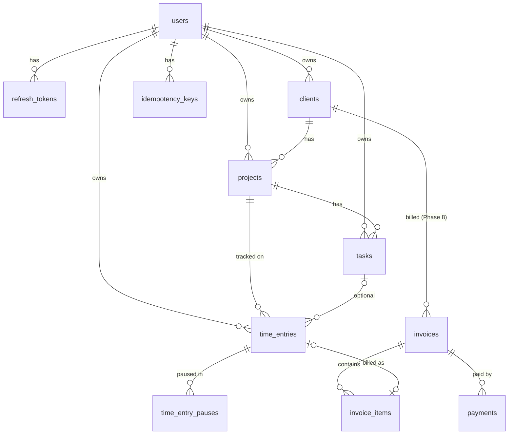

# FreelanceHub — Database

> Status: **v0.5 — implemented through migration 0005.** Target: **PostgreSQL 16**. Migrations: Alembic.
> Related: [architecture.md](architecture.md) · [api.md](api.md)

## 1. Conventions

- Primary keys: `UUID`. They are generated in Python (`uuid.uuid4()`), or **by the client** for timer-started time entries (see ADR-08).
- Timestamps: `TIMESTAMPTZ`, stored in UTC, microsecond precision. Every table has `created_at` and `updated_at` (`DEFAULT now()`). `updated_at` is maintained by the ORM.
- Money: `NUMERIC(10,2)` for rates and `NUMERIC(14,2)` for amounts. Currency: `CHAR(3)` ISO-4217 with a CHECK against the supported list.
- Enums: PostgreSQL native enums created in migrations (`time_entry_status`, `project_status`, …).
- Naming convention (SQLAlchemy `MetaData(naming_convention=…)`): `pk_%(table)s`, `fk_%(table)s_%(column_0)s_%(referred_table)s`, `uq_…`, `ck_…`, `ix_…`. This keeps migrations deterministic and reversible.
- **Ownership**: every user-owned table has `user_id NOT NULL`. Child tables reference parents with **composite FKs `(parent_id, user_id) → parent(id, user_id)`**, which makes cross-user links impossible at the DB level. Each parent therefore has `UNIQUE (id, user_id)`.
- Extensions: `citext` (case-insensitive email), `btree_gist` (exclusion constraint on time entries).
- Archiving instead of deleting for clients and projects (`archived_at`). Hard delete is allowed only when nothing references the row.

## 2. Entity-relationship diagram



## 3. Tables

### 3.1 `users`

| Column | Type | Constraints / notes |
|--------|------|---------------------|
| id | UUID | PK |
| email | CITEXT | NOT NULL, UNIQUE. Normalised (trimmed, lowercased) |
| password_hash | TEXT | NOT NULL, Argon2id encoded string |
| full_name | VARCHAR(120) | NOT NULL |
| timezone | VARCHAR(64) | NOT NULL DEFAULT 'UTC'. IANA name validated in the app (`zoneinfo`) |
| default_currency | CHAR(3) | NOT NULL DEFAULT 'USD', CK supported currencies |
| default_hourly_rate | NUMERIC(10,2) | NULL, CK `>= 0` |
| week_start | SMALLINT | NOT NULL DEFAULT 1 (1 = Monday … 7 = Sunday), CK 1–7 |
| created_at, updated_at | TIMESTAMPTZ | |

### 3.2 `refresh_tokens`

| Column | Type | Constraints / notes |
|--------|------|---------------------|
| id | UUID | PK |
| user_id | UUID | FK → users ON DELETE CASCADE |
| family_id | UUID | NOT NULL. All rotations of one login share it |
| token_hash | CHAR(64) | NOT NULL UNIQUE, hex SHA-256 of the token |
| expires_at | TIMESTAMPTZ | NOT NULL |
| revoked_at | TIMESTAMPTZ | NULL |
| rotated_at | TIMESTAMPTZ | NULL. Set when replaced (used for the reuse grace window) |
| replaced_by_id | UUID | NULL, FK → refresh_tokens |
| user_agent | VARCHAR(200) | NULL, truncated |
| created_at | TIMESTAMPTZ | |

Indexes: `ix_refresh_tokens_user_id`, `ix_refresh_tokens_family_id`.

### 3.3 `clients`

| Column | Type | Constraints / notes |
|--------|------|---------------------|
| id | UUID | PK. `UNIQUE (id, user_id)` |
| user_id | UUID | FK → users ON DELETE CASCADE |
| name | VARCHAR(120) | NOT NULL |
| email | VARCHAR(254) | NULL |
| company | VARCHAR(160) | NULL |
| notes | TEXT | NULL, max 5000 enforced in schema |
| default_hourly_rate | NUMERIC(10,2) | NULL, CK `>= 0` |
| currency | CHAR(3) | NOT NULL, CK supported. Defaults to `users.default_currency` |
| archived_at | TIMESTAMPTZ | NULL |
| created_at, updated_at | TIMESTAMPTZ | |

Indexes: `uq_clients_user_name` UNIQUE `(user_id, lower(name)) WHERE archived_at IS NULL`; `ix_clients_user_id`.

### 3.4 `projects`

| Column | Type | Constraints / notes |
|--------|------|---------------------|
| id | UUID | PK. `UNIQUE (id, user_id)` |
| user_id | UUID | FK → users ON DELETE CASCADE |
| client_id | UUID | NOT NULL. **FK (client_id, user_id) → clients(id, user_id) ON DELETE RESTRICT** |
| name | VARCHAR(120) | NOT NULL |
| description | TEXT | NULL |
| status | project_status | NOT NULL DEFAULT 'active' — `active, on_hold, completed` |
| billing_type | billing_type | NOT NULL DEFAULT 'hourly' — `hourly, fixed, non_billable` |
| hourly_rate | NUMERIC(10,2) | NULL, CK `>= 0`. Used only when `billing_type='hourly'` |
| fixed_fee | NUMERIC(14,2) | NULL, CK `fixed_fee IS NOT NULL` when `billing_type='fixed'` |
| currency | CHAR(3) | NOT NULL, defaults to the client currency |
| budget_hours | NUMERIC(8,2) | NULL, CK `> 0` |
| deadline | DATE | NULL |
| color | CHAR(7) | NOT NULL DEFAULT '#8B7CFF', CK `^#[0-9A-Fa-f]{6}$` |
| archived_at | TIMESTAMPTZ | NULL |
| created_at, updated_at | TIMESTAMPTZ | |

Indexes: `ix_projects_user_status (user_id, status) WHERE archived_at IS NULL`; `ix_projects_client_id`;
`uq_projects_client_name` UNIQUE `(client_id, lower(name)) WHERE archived_at IS NULL`.

### 3.5 `tasks`

| Column | Type | Constraints / notes |
|--------|------|---------------------|
| id | UUID | PK. `UNIQUE (id, user_id)` |
| user_id | UUID | FK → users ON DELETE CASCADE |
| project_id | UUID | **FK (project_id, user_id) → projects(id, user_id) ON DELETE CASCADE** |
| title | VARCHAR(200) | NOT NULL |
| description | TEXT | NULL |
| status | task_status | NOT NULL DEFAULT 'todo' — `todo, in_progress, done` |
| priority | task_priority | NOT NULL DEFAULT 'medium' — `low, medium, high` |
| due_date | DATE | NULL |
| estimate_minutes | INTEGER | NULL, CK `> 0` |
| position | INTEGER | NOT NULL DEFAULT 0 (manual ordering within the project) |
| completed_at | TIMESTAMPTZ | NULL. Set when status → done |
| created_at, updated_at | TIMESTAMPTZ | |

Indexes: `ix_tasks_project_status (project_id, status, position)`; `ix_tasks_user_due (user_id, due_date) WHERE status <> 'done'`.

> A project with time entries cannot be hard-deleted (RESTRICT from `time_entries`), so the CASCADE from projects to tasks only ever fires for projects without tracked time.

### 3.6 `time_entries` (core)

| Column | Type | Constraints / notes |
|--------|------|---------------------|
| id | UUID | PK. **May be client-generated** (timer start). `UNIQUE (id, user_id)` |
| user_id | UUID | FK → users ON DELETE CASCADE |
| project_id | UUID | **FK (project_id, user_id) → projects(id, user_id) ON DELETE RESTRICT** |
| task_id | UUID | NULL. **FK (task_id, user_id) → tasks(id, user_id) ON DELETE SET NULL (task_id)** (column list for SET NULL, PostgreSQL ≥ 15) |
| description | VARCHAR(500) | NOT NULL DEFAULT '' |
| source | entry_source | NOT NULL — `timer, manual` |
| status | time_entry_status | NOT NULL — `running, paused, stopped` |
| started_at | TIMESTAMPTZ | NOT NULL |
| ended_at | TIMESTAMPTZ | NULL |
| duration_seconds | INTEGER | NULL. Net of pauses, set on stop or edit. CK `>= 0` |
| billable | BOOLEAN | NOT NULL. Default derived from the project `billing_type='hourly'` |
| hourly_rate_snapshot | NUMERIC(10,2) | NULL. Copied at creation, immutable except through correction |
| currency | CHAR(3) | NOT NULL. Snapshot |
| rate_source | rate_source | NOT NULL — `project, client, user, none` |
| rate_corrected_at | TIMESTAMPTZ | NULL. Set by an explicit `reprice` |
| billable_amount | NUMERIC(14,2) | NULL. Set on stop or edit. NULL when not billable or no rate |
| invoice_id | UUID | **Not yet created** — added with invoices (Phase 8 migration) |
| version | INTEGER | NOT NULL DEFAULT 1. Optimistic lock (SQLAlchemy `version_id_col`) |
| created_at, updated_at | TIMESTAMPTZ | |

Constraints:
```sql
CHECK ((status = 'stopped') = (ended_at IS NOT NULL))                         -- ck_time_entries_stopped_has_end
CHECK (ended_at IS NULL OR ended_at > started_at)                             -- ck_time_entries_end_after_start
CHECK ((status = 'stopped') = (duration_seconds IS NOT NULL))                 -- ck_time_entries_duration_when_stopped
CHECK (source = 'timer' OR status = 'stopped')                                -- manual entries are always stopped
CHECK (billable_amount IS NULL OR billable_amount >= 0)
CHECK (source = 'timer' OR ended_at - started_at <= interval '24 hours')      -- manual entry cap

-- At most one active timer per user
CREATE UNIQUE INDEX ux_time_entries_one_active
  ON time_entries (user_id) WHERE status IN ('running', 'paused');

-- No overlapping entries per user (running entry = open-ended range)
ALTER TABLE time_entries ADD CONSTRAINT ex_time_entries_no_overlap
  EXCLUDE USING gist (user_id WITH =, tstzrange(started_at, ended_at, '[)') WITH &&);
```

Indexes: `ix_time_entries_user_started (user_id, started_at DESC, id DESC)` for list pagination and analytics;
`ix_time_entries_project_started (project_id, started_at)`; `ix_time_entries_unbilled (user_id) WHERE invoice_id IS NULL AND billable AND status='stopped'`.

### 3.7 `time_entry_pauses`

| Column | Type | Constraints / notes |
|--------|------|---------------------|
| id | UUID | PK |
| time_entry_id | UUID | FK → time_entries ON DELETE CASCADE |
| paused_at | TIMESTAMPTZ | NOT NULL |
| resumed_at | TIMESTAMPTZ | NULL while paused. CK `resumed_at IS NULL OR resumed_at >= paused_at` |

Indexes: `ux_pauses_one_open` UNIQUE `(time_entry_id) WHERE resumed_at IS NULL`; `ix_pauses_entry (time_entry_id, paused_at)`.

Ownership is inherited through `time_entry_id` and is only accessed through the parent entry. When a stopped entry's
times are edited and the new range excludes some pauses, those pauses are **clipped or removed** by the service
inside the same transaction (documented behaviour, covered by tests).

### 3.8 `idempotency_keys`

| Column | Type | Constraints / notes |
|--------|------|---------------------|
| user_id | UUID | PK part. FK → users ON DELETE CASCADE |
| key | VARCHAR(100) | PK part. Client UUID string |
| endpoint | VARCHAR(100) | NOT NULL, e.g. `POST /timer/start` |
| request_hash | CHAR(64) | NOT NULL. SHA-256 of the canonical JSON body + path params |
| status_code | SMALLINT | NOT NULL |
| response_body | TEXT | NOT NULL. Exact response bytes (JSONB would reorder keys; replays must be byte-identical) |
| created_at | TIMESTAMPTZ | NOT NULL DEFAULT now(). `ix_idempotency_created` used by cleanup (TTL 48 h) |

Flow: inside the request transaction → `INSERT … ON CONFLICT DO NOTHING RETURNING`. If the insert succeeds, the
mutation runs and the stored response is updated before commit. On conflict, the existing row is read. A concurrent
duplicate blocks on the unique index until the first transaction commits, then **replays** the stored response, or
returns `422 IDEMPOTENCY_KEY_REUSED` if `request_hash` differs.

### 3.9 Invoices, items, payments (migration `0005_invoices_payments`)

**`invoices`**: `id`, `user_id` FK CASCADE, `client_id` (composite FK `(client_id, user_id) → clients(id, user_id)` RESTRICT,
so an invoice can never point at another user's client), `number VARCHAR(30)` (`UNIQUE (user_id, number)`, format
`INV-2026-0001`, assigned on send), `status invoice_status` (`draft, sent, paid, void`; *overdue* is **derived**:
`sent AND due_date < today` in the user TZ), `issue_date DATE`, `due_date DATE`, `currency CHAR(3)`,
`subtotal / tax_amount / total NUMERIC(14,2)`, `tax_rate NUMERIC(5,2)` (percent), `notes TEXT`,
snapshots `bill_to_name / bill_to_company / bill_to_email / from_name / from_email` (taken on send, so renaming a client
never rewrites an issued invoice), `sent_at`, `paid_at`, `voided_at`, `version`, timestamps.
Constraints: `due_date >= issue_date`; `tax_rate` 0–100; amounts ≥ 0; **`total = subtotal + tax_amount`**;
`(status = 'draft') = (number IS NULL)`, `(status = 'draft') = (sent_at IS NULL)`, `(status = 'paid') = (paid_at IS NOT NULL)`,
`(status = 'void') = (voided_at IS NOT NULL)`; supported currency. Indexes: `(user_id, status)`,
`(user_id, created_at DESC, id DESC)` for the cursor list, `client_id`.

**`invoice_items`**: `id`, `invoice_id` FK CASCADE, `kind invoice_item_kind` (`time | custom`), `time_entry_id` FK SET NULL,
`description VARCHAR(500)`, `service_date DATE`, `duration_seconds` (required for time lines), `quantity NUMERIC(12,4)`
(hours = seconds/3600 for time lines, display only), `unit_price NUMERIC(10,2)`, `amount NUMERIC(14,2)` (**copied from
`time_entries.billable_amount`** for time lines, so it reconciles exactly), `position`. Non-negative checks on money.

**`payments`**: `id`, `user_id`, `invoice_id` (composite FK `(invoice_id, user_id)` RESTRICT), `amount NUMERIC(14,2)` CK `> 0`,
`paid_on DATE` (local date, not in the future), `method payment_method` (`bank_transfer, card, cash, paypal, other`),
`note VARCHAR(500)`, `created_at`. The currency is the invoice's. Index `(user_id, paid_on)` serves "received in period".

**`time_entries.invoice_id`**: composite FK `(invoice_id, user_id) → invoices(id, user_id)` `ON DELETE SET NULL (invoice_id)`,
CK `invoice_id IS NULL OR status = 'stopped'`, index. One column ⇒ an entry is on **at most one** invoice. It is set when the
entry is put on a draft (the entry is then locked) and cleared when the draft is deleted or the invoice voided.

Service rules (under the per-user `FOR NO KEY UPDATE` lock that also serialises timer commands): Σ payments ≤ total —
when Σ = total the status becomes `paid`, deleting a payment returns it to `sent`; numbers are taken as
`max(number of the year) + 1` inside the lock, so issued numbers have no gaps or duplicates;
`tax_amount = quantize(subtotal × tax_rate / 100, 0.01, HALF_UP)`.

## 4. Key queries

```sql
-- Current timer (with pauses)
SELECT * FROM time_entries WHERE user_id = :uid AND status IN ('running','paused');

-- Unbilled per currency: not on a sent/paid invoice (entries on a draft still count as unbilled)
SELECT e.currency, SUM(e.billable_amount), SUM(e.duration_seconds)
FROM time_entries e LEFT JOIN invoices i ON i.id = e.invoice_id
WHERE e.user_id = :uid AND e.status = 'stopped' AND e.billable
  AND (e.invoice_id IS NULL OR i.status = 'draft')
GROUP BY e.currency;

-- Received in a period (local dates)
SELECT i.currency, SUM(p.amount) FROM payments p JOIN invoices i ON i.id = p.invoice_id
WHERE p.user_id = :uid AND p.paid_on BETWEEN :from AND :to GROUP BY i.currency;

-- Daily series in the user's timezone (bucket = local date of started_at)
SELECT (started_at AT TIME ZONE :tz)::date AS day, currency,
       SUM(duration_seconds) AS seconds, SUM(billable_amount) AS amount
FROM time_entries
WHERE user_id = :uid AND status = 'stopped'
  AND started_at >= :from_utc AND started_at < :to_utc
GROUP BY 1, 2 ORDER BY 1;
```

## 5. Migration policy

- One Alembic revision per logical change. Autogenerate is reviewed by hand, because partial indexes, exclusion constraints, and enums need manual edits.
- **Every revision implements `downgrade()`**. CI runs `upgrade head → downgrade base → upgrade head` against a fresh Postgres.
- Revisions:
  1. `0001_extensions_users_auth`: citext, btree_gist, users, refresh_tokens
  2. `0002_clients_projects`
  3. `0003_tasks`
  4. `0004_time_entries`: entries, pauses, idempotency_keys, constraints
  5. `0005_invoices_payments`: invoices, invoice_items, payments, `time_entries.invoice_id`
- Data-changing migrations, when they exist, are written idempotently and in batches.

## 6. Seed data

`python -m app.cli.seed_demo` (Windows: `scripts/seed-demo.cmd`) creates the demo account
`demo@freelancehub.app` / `FreelanceHub-demo-2026` for screenshots and screencasts: 4 clients (USD and EUR), 7 projects
(hourly, fixed fee, non-billable, budgets), ~160 time entries over the last ~75 days, 7 invoices in every state
(paid, void + re-issued, overdue, part-paid, open, draft) and a running timer. It goes through the services, so all
amounts come from the real rules; it is deterministic (fixed random seed) relative to today in `Europe/Kyiv`, replaces
only the demo user when re-run, and refuses to run with `ENVIRONMENT=production` unless `--force` is given.
Tested on three dates (mid-month, the 1st of a month, New Year) in `tests/integration/test_seed_demo.py`.
